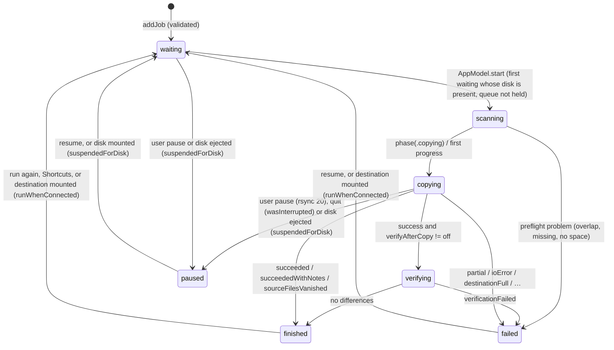

# Symbolic Memory Graph — State Topology & Node Lookup

> **Memory Category:** TencentDB Symbolic Short-Term Memory Topo-Graph
> **Scope:** State machines, execution pipelines, and symbolic `node_id` lookup for `Copiator`.

---

## 1. Symbolic Node Lookup Table

| `node_id` | Symbol | File | Role |
| :--- | :--- | :--- | :--- |
| `N_APP_MODEL` | `AppModel` | `Sources/Copiator/AppModel.swift` | Queue owner, engine probe, updates, verify, persistence |
| `N_SETTINGS` | `AppSettings` | `Sources/Copiator/AppSettings.swift` | Preferences, shortcuts, localization |
| `N_QUEUE` | `JobQueue` | `Sources/CopiatorCore/JobStore.swift` | Pure transitions and ordering |
| `N_STORE` | `JobStore` | `Sources/CopiatorCore/JobStore.swift` | `jobs.json` |
| `N_ENGINE` | `RsyncEngine` | `Sources/CopiatorCore/RsyncEngine.swift` | Transfer and verify pipelines |
| `N_CMD` | `RsyncCommand` | `Sources/CopiatorCore/RsyncCommand.swift` | Arguments |
| `N_RUNNER` | `CommandRunner` | `Sources/CopiatorCore/CommandRunner.swift` | Process execution |
| `N_SANDBOX` | `SandboxProfile` | `Sources/CopiatorCore/Sandbox.swift` | SBPL |
| `N_PROGRESS` | `RsyncProgressParser` | `Sources/CopiatorCore/RsyncProgress.swift` | Progress |
| `N_OUTCOME` | `RsyncOutcome` | `Sources/CopiatorCore/RsyncOutcome.swift` | Result classes |
| `N_GUARD` | `DiskSpaceGuard` | `Sources/CopiatorCore/DiskSpace.swift` | In-copy floor |
| `N_SLEEP` | `SleepAssertion` | `Sources/CopiatorCore/SleepAssertion.swift` | Idle-sleep prevention |
| `N_SNAPSHOTS` | `SnapshotStore` | `Sources/CopiatorCore/Snapshots.swift` | Dated snapshot folders, `Latest`, retention |
| `N_ORPHANS` | `ChildProcessGuard` | `Sources/CopiatorCore/ChildProcessGuard.swift` | Child registry, crash handlers, launch reaping |
| `N_VOLUMES` | `VolumeWatcher` | `Sources/Copiator/StatusItems.swift` | Mount/unmount events → `AppModel` |
| `N_INTENTS` | `RunJobIntent` & co. | `Sources/Copiator/Intents.swift` | Shortcuts and Siri entry points |

## 2. Job State Machine



## 3. Transfer Pipeline (`N_ENGINE`)

```mermaid
flowchart TD
    A[JobValidation] --> S{snapshots?}
    S -- yes --> P[SnapshotStore.prepare: reuse or create .partial, --link-dest newest]
    S -- no --> B
    P --> B[DiskSpace preflight: source − existing ≤ free − reserve]
    B --> C[SandboxProfile.forTransfer + protectedPaths]
    C --> D[RsyncCommand.transfer]
    D --> E[DiskSpaceGuard.run → CommandRunner.run, records → RsyncProgressParser → ProgressThrottle]
    E --> F[RsyncOutcome.classify + errorLines]
    F --> G{xattrs copied?}
    G -- no --> H[Quarantine.propagate]
    G -- yes --> I[JobResult]
    H --> I
    I --> V{verifyAfterCopy?}
    V -- yes --> W[compare: -n -i (-c)] --> X
    V -- no --> X{snapshot?}
    X -- yes --> Y[finalize: rename, Latest, prune on full success]
```
