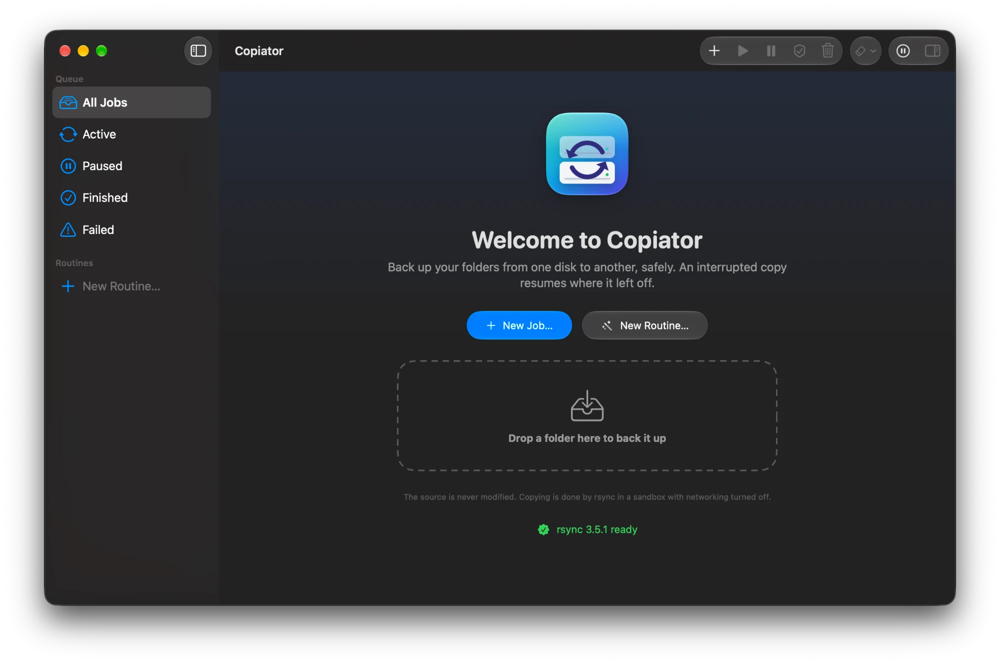

# Copiator

A native backup and sync app for macOS 26+, built with SwiftUI and Liquid Glass on top of [rsync](https://rsync.samba.org). It is built as a universal app (Apple Silicon + Intel), and a dependency-free universal rsync 3.5.1 ships inside the app bundle.

Copiator copies from a local disk to a local disk (internal, external, USB or network-mounted volumes). The job model and the engine layer are engine-independent, so other engines can be added as new job kinds.

<p align="center">
  
</p>

## Features

- **Job queue** (like Transmission): every job has a source, a destination, options, a status (waiting, waiting for disk, scanning, copying, verifying, paused, finished, failed), progress, speed, time left and a log. Jobs run one at a time in list order; drag to reorder.
- **Resume:** an interrupted job continues with the same command (`--partial`); only what is missing is copied. Pausing, quitting the app or a full disk never loses work.
- **Honest progress:** bytes copied, percentage, speed, time left and checked items come from rsync's `--info=progress2`. While rsync is still scanning (`ir-chk`), the row says the estimate is not final.
- **Verify:** runs the same job as a dry run (`-n -i`, optionally with checksums `-c`) and lists missing, changed and extra items. Nothing is changed. Jobs can also **verify automatically after copying** (quick or checksum); differences fail the job and are written to its log.
- **Preview before adding:** the New Job sheet can dry-run the job and list what will be copied, updated and — when `--delete` is on — deleted, highlighted in red.
- **Automatic snapshots:** every run writes a dated folder (`yyyy-MM-dd-HHmmss`) in the destination; unchanged files are hard-linked to the previous snapshot (`--link-dest`, no extra space), `Latest` points to the newest, an interrupted snapshot is resumed, and optional retention rules (keep the last N, one per day/week/month) delete expired snapshots only after a successful run.
- **Start when the destination disk is connected:** the job waits (instead of failing) while the disk is missing and starts when it is plugged in, even if it already finished. Ejecting a disk pauses the job using it; reconnecting resumes it.
- **Copy routines:** a library in the sidebar of named, reusable routines with Finder-style rules. Each route copies the files in a source folder that match its rules to a destination, keeping the folder structure; add routes to send different files to different places. Conditions on name, extension, any folder name in the path, relative path (contains, is, begins with, ends with, regular expression) and file kind (image, movie, audio, PDF, document, spreadsheet, presentation, text, source code, archive, application), combined with All / Any / None and nested groups. Advanced criteria: size, date modified/created/added, Finder tags, visibility (hidden files), folder depth, an extension list ("jpg, heic, png"), date taken, resolution, duration and camera model of photos and videos, and text inside files (Spotlight). Rules are evaluated on every run; a "Try" field shows which routes a sample path matches, and each route has a preview. Routines can be run from the sidebar, the menu bar and Shortcuts.
- **Placement:** routes can also put files into date folders (`2026/10-Ekim`) and give them a new name from a template (`123456789_El_{month}_{yy}`), using the date taken, the date in the file name or contents (PDF and text, also without Spotlight), or the file dates. Name fixes (regular expressions with upper, lower or title case), a `{targetNumber}` token that reads a number such as `Elektrik (123456789)` from the destination folder, and a mode that suggests a folder for every file and asks before copying (remembering your choices) cover the rest. A "copy with the same contents at the destination" criterion skips files that are already archived under any name.
- **Send files to a routine:** select files in Finder and choose **Send to a Copiator Routine** (or the "Run Copy Routine on Files" Shortcuts action, or drop them on a routine in the sidebar): the routine's rules and placement are applied to just those files.
- **Move and clean up:** a job or routine can move its source files to the Trash once their copies are verified to be identical, and **Clean Up Archived Sources…** finds files that are already archived anywhere at the destination. Nothing is ever deleted permanently.
- **Two-way sync routines:** keep two folders in step (for example a disk and a folder on the Mac): missing files are copied both ways, files that differ are asked about or decided by "newer wins", and nothing is deleted.
- **On-device AI suggestions:** with Apple Intelligence, the folder suggestions can be ranked and a name template can be suggested from the files already at the destination, on the Mac only and always for your approval. The model works best in English; the app warns that suggestions for Turkish, Romanian and other names may be weaker. A local Ollama or LM Studio model can be used instead (127.0.0.1 only, cloud models excluded), or all three in an automatic order where an unreachable model is skipped without an error, and the AI can also suggest paths: a subfolder template, or a folder (new if needed) for each file.
- **Destination overview and folder suggestions:** see how full a destination is and what takes the space, and let the routine editor suggest the best existing folder for a file name.
- **Backup reminder:** when a disk is connected, Copiator tells you which jobs and routines that copy to it have not run successfully for a while (30 days by default; off, 7–90 days in Settings).
- **Restore from snapshots:** browse a job's snapshots, see a file's versions over time, preview files with Quick Look and restore a file, a folder or everything to where it was or to another folder, as an ordinary copy job that asks before replacing anything.
- **Battery-safe:** on a critically low battery the running job pauses and no new job starts; plugging in the adapter resumes it.
- **Destination fill forecast:** the inspector estimates from the free space after past runs when the destination disk will be full, always as a range ("about 4–6 months"), warns a few weeks ahead and suggests a snapshot retention rule.
- **Diagnostic report:** Help › Diagnostic Report… previews a plain-text report for bug reports, with your user name, home folder and the names of disks, folders and files masked; it is saved only where you choose and never sent anywhere.
- **Low disk priority:** optionally run rsync in macOS's background class so a long backup does not slow down the apps you are using.
- **Move to another Mac:** export your jobs and settings to one file and import them on the other Mac; jobs arrive paused, missing folders can be chosen again, and security and network choices stay as they are on the new Mac.
- **Search and compare snapshots:** find a file or folder by name across all snapshots of a job, and see which files were added, changed or removed between any two snapshots, without reading the files or running rsync.
- **Archive integrity and duplicates:** check whether the files at a destination are still the same as when they were last checked (silent corruption is reported, nothing is changed but a hidden list), optionally every time the disk is connected, and find files with identical contents so the extra copies can go to the Trash after confirmation.
- **Repair from intact copies:** a damaged file can be rewritten from a copy with exactly the recorded digest found in an older snapshot or in the job's source, fixing hard-linked snapshot copies at the same time.
- **Eject when done:** a job or routine can eject its destination disk after a successful run, as soon as nothing else uses it, so the disk can be unplugged right away.
- **Notification buttons:** Back Up Now on the old backup reminder, Show on integrity problems and Decide on jobs that need a decision.
- **Export and import routines:** move routines to another Mac as a file; imported routines get new identities and missing folders can be pointed elsewhere before importing.
- **Files with the same name:** before copying, Copiator lists every file that already exists at the destination under the same name (even with identical contents) and asks what to do: **1 · Replace**, **2 · Keep Both** (the new file is copied as `report 2.xlsx`, Finder-style) or **3 · Skip**, for all files at once or file by file, optionally remembered for the job or routine. A folder arriving where a file of the same name exists (or a file where a folder or link exists) is asked about too, instead of rsync silently deleting what is there; Keep Both then renames the existing item. If nobody is around (e.g. a routine started by connecting a disk), the job waits as "Needs decision", a notification arrives and the next jobs continue. Jobs and routines can also be set to replace, keep both or skip without asking.
- **Edit and duplicate jobs** without losing their history; every run is recorded in the job's **history** (result, duration, bytes, files, snapshot).
- **Ready-made exclude lists:** developer folders (`node_modules`, `DerivedData`, `.build`, `Pods`, Python and JavaScript caches), version control (`.git`, `.svn`, `.hg`), caches (`Library/Caches`, `.cache`) and macOS helper files (`.DS_Store`, `._*`, Trash).
- **Menu bar and Dock:** a menu bar icon with the running job's progress and pause/resume all (Copiator keeps running without a window while it is on), and a bright green progress bar with the copy speed on the Dock icon while a job runs.
- **Shortcuts and Siri:** "Run Copy Job", "Run Copy Routine", "Pause All Jobs" and "Resume All Jobs" actions, e.g. "Run Photos in Copiator".
- **No orphaned rsync:** if Copiator crashes or is terminated, the running rsync is stopped; one left over from a killed session is stopped at the next launch.
- **Copy mode:** "copy the folder itself" (`Source` → `Destination/Source/…`) or "copy its contents" (`Source/` → `Destination/…`), with a preview of the result.
- **Every rsync option that works in the sandbox:** filters and list files, size limits, hard links, creation/access times, symlink handling, sparse/in-place/append writes, deletion details, size-only comparison, time tolerance, bandwidth limit, stop after/at a time, file-name encoding, a manually chosen previous backup (`--link-dest`, `--compare-dest`, `--copy-dest`), old versions (`--backup-dir`), per-file or exact progress, current file name, statistics, change log, log and batch files. Defaults in **Settings › rsync**, per job in the New Job sheet; the exact `rsync …` command is shown before it runs. See [docs/rsync-possible-in-sandbox.md](docs/rsync-possible-in-sandbox.md) and [docs/rsync-not-possible-in-sandbox.md](docs/rsync-not-possible-in-sandbox.md).
- **Safe by default:**
  - the source is never modified (`--remove-source-files` is never used; the sandbox makes the source read-only even inside the destination);
  - deleting extra files at the destination (`--delete`) only when chosen per job and confirmed;
  - rsync runs in a `sandbox-exec` sandbox with networking off, writes only to the destination and cannot read personal folders (`~/.ssh`, Keychains, browser profiles…) unless you choose them as the source;
  - if macOS's `sandbox-exec` is ever missing, jobs are refused instead of running rsync unprotected (unless you turn the sandbox off yourself in Settings › Advanced);
  - jobs whose source and destination overlap are refused;
  - free space is checked before copying and watched while copying.
- **exFAT/FAT disks:** permissions, owners and ACLs are not sent to disks that cannot store them; harmless "failed to set times / permissions" warnings become one info line; FAT gets `--modify-window=1` so re-runs do not recopy everything.
- **macOS details:** system folders (`.Spotlight-V100`, `.Trashes`, `.fseventsd`, `.TemporaryItems`…) are left out; the quarantine flag of downloaded files is kept even when extended attributes are not copied; a notification arrives when a job finishes.
- **Sleep and power:** while a job runs the Mac does not idle-sleep (the same assertion as `caffeinate -i`, optionally `-d` for the display). Copiator checks the assertion in the system's own list (what `pmset -g assertions` shows), tells you when it is taken and released (start, finish, pause, cancel), and advises about battery, Low Power Mode, the lid and the display; the power state is re-checked every minute during a job.
- **Finder:** right-click › **Back Up with Copiator**, or drop a folder on the window.
- **Languages:** Turkish (default), English, Romanian. **Appearance:** Automatic, Light, Dark.
- **rsync updater:** downloads the latest release from [github.com/RsyncProject/rsync](https://github.com/RsyncProject/rsync/releases), verifies its SHA-256 and builds it on your Mac (needs the Xcode Command Line Tools).

## Installation

**Requires:** macOS 26 (Tahoe) or later. Runs on Apple Silicon and Intel Macs.

1. Download the latest `Copiator-<version>.dmg` from the [Releases](https://github.com/berkbb/copiator-mac-universal/releases) page.
2. Optionally verify the download in the folder you downloaded it to:
   ```bash
   shasum -a 256 -c SHA256SUMS.txt --ignore-missing
   ```
3. Open the `.dmg` and drag **Copiator** into the **Applications** folder.
4. **First launch:** Copiator is ad-hoc signed rather than signed with an Apple Developer ID, so macOS shows a "Copiator can't be opened" warning the first time.
   - Close the warning with **Done**.
   - Go to **System Settings › Privacy & Security**, click **Open Anyway** next to "Copiator was blocked", and confirm with your password.
   - Or, instead of the two steps above, remove the quarantine flag in Terminal. Only do this for a copy you downloaded from the Releases page above:
     ```bash
     xattr -dr com.apple.quarantine /Applications/Copiator.app
     ```
   - You only need to do this once, although macOS may ask again after an update.
5. On first launch, Copiator asks for permission to send notifications and to check GitHub for updates. You can change the update check later in **Settings › Advanced**.

**Permissions:** open Copiator from the **Applications** folder; macOS offers notifications only to apps opened from there, and Copiator shows a banner with **Show in Finder** if it is opened elsewhere. When notifications are turned off, a banner opens **System Settings › Notifications** for you. macOS asks on its own the first time a job reads your Desktop, Documents or Downloads folder, an external or network disk, or a cloud folder; each question says why. If a job or routine touches a folder macOS protects (the whole home folder, Mail, Safari, Photos, the Trash and similar), a banner asks for **Full Disk Access** and opens **System Settings › Privacy & Security › Full Disk Access**; if the window is closed at that moment, a notification says so. **Settings › General › Permissions** shows both permissions at any time, with a button for each. Because Copiator is ad-hoc signed, macOS may forget that permission after an update: if the banner comes back while Copiator is already on in that list, turn it off and on again.

**Finder context menu:** "Back Up with Copiator" appears under right-click › **Quick Actions** or **Services**. If it is missing, enable it in System Settings › Keyboard › Keyboard Shortcuts › Services › Files and Folders.

## Development

Double-click in Finder:

- **`Paketle.command`** (package): runs the tests and produces a universal `build/Copiator.app` plus a `.dmg`, an Ed25519 signature (`.dmg.sig`) and `SHA256SUMS.txt` under `dist/`.
- **`rsync-Guncelle.command`** (update rsync): updates `Vendor/rsync` and, if present, the rsync inside `build/Copiator.app`.
- **`Yayimla.command`** (publish): shows a dry run first; if you confirm, packages the release and uploads it to GitHub Releases. GitHub Actions is not used.

The same tasks from the terminal:

```bash
./Scripts/build-rsync.sh              # build Vendor/rsync from the v3.5.1 tag (universal, /usr/lib only)
./Scripts/update-rsync.sh check       # is a newer rsync available?
./Scripts/update-rsync.sh install     # download, verify, build and install into Vendor/rsync
./Scripts/build_app.sh                # build/Copiator.app only
./Scripts/package.sh                  # tests + .app + .dmg + .dmg.sig + SHA256SUMS.txt
./Scripts/set-version.sh 1.0.1        # change the version (single source: Support/Info.plist)
./Scripts/release.sh --dry-run        # rehearse a release without sending anything
./Scripts/stress-test.sh              # pre-release stress round
swift test                            # unit, integration (real rsync), chaos/security matrix, fuzz and UI-render tests
```

Requires Xcode 26 or later. See [DEVELOPMENT.md](DEVELOPMENT.md) for the architecture, [roadmap.md](.agents/context/roadmap.md) for planned features and [CHANGELOG.md](CHANGELOG.md) for release notes. Coding agents start from [.agents/AGENTS.md](.agents/AGENTS.md); an optional code knowledge graph is built locally with [Graphify](https://github.com/Graphify-Labs/graphify) (see DEVELOPMENT.md › Agent tooling).

## License

Copiator is free software under the GNU General Public License, version 3 only ([GPL-3.0-only](LICENSE)); © Babadogan Tech and Edu. The bundled rsync keeps its own license, GPL-3.0-or-later, and is run as a separate, unmodified program; its exact source, build flags and checksum are in [Vendor/rsync/SOURCE.txt](Vendor/rsync/SOURCE.txt). Some components are derived from another GPL-3.0-only project of the same copyright holder; see [THIRD_PARTY_NOTICES.md](THIRD_PARTY_NOTICES.md).
